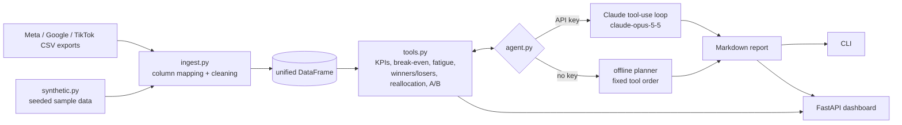

# AdPilot - an AI media-buyer agent

Drop in your Meta / Google / TikTok ads export and get a media buyer's analysis: **what to kill, what to scale, which creatives are fatigued, how to move budget, and new hooks to test.** AdPilot is an agent built on Claude (`claude-opus-5-5`) that decides which analysis tools to call and writes the report. With no API key it runs a deterministic offline planner so you can try it in seconds.

> **AdPilot only recommends.** It reads the CSV you give it. It has no credentials for, and no tool that can touch, any live ad account: it never changes a budget, pauses an ad or publishes a creative.
>
> **All sample data is SYNTHETIC** (seeded random generator). No real client data is in this repo.

Example output: [`examples/report.md`](examples/report.md) (generated offline from the synthetic data).

## Why I built this

I spent three years (2022-2025) as a freelance media buyer on Meta, Google and TikTok Ads: A/B testing creatives, building KPI dashboards, pushing ROAS up and CPA down. The routine was always the same: export a CSV, work out break-even, kill the losers, scale the winners, notice which creative had worn out, brief new hooks. That is the *analyst* half of the job, and it is mechanical enough to automate. AdPilot encodes that checklist as tested tools and lets an LLM agent orchestrate them. The judgement calls (when not to trust a number, e.g. tiny spend or a non-significant A/B test) are baked into the tools.

## Features

- **Ingestion** of Meta Ads Manager, Google Ads and TikTok Ads Manager style CSVs (header aliasing, `$1,200.50` and `"10,000"` number cleaning, Google title rows and `Total` rows skipped) into one schema: `date, platform, campaign, adset, ad, spend, impressions, clicks, purchases, revenue, frequency`.
- **Tools** (pure Python, unit-tested): `compute_kpis`, `breakeven_roas`, `detect_creative_fatigue`, `find_winners_losers` (minimum-spend guard), `propose_budget_reallocation` (capped per-day moves), `ab_test_significance` (two-proportion z-test), `generate_ad_hooks` (LLM, template fallback).
- **Agent**: manual tool-use loop with the official `anthropic` SDK; the model chooses the tools and writes the markdown report.
- **Offline mode**: no key, no network. A fixed-order planner calls the same tools and fills a report template; hooks come from templates.
- **Interfaces**: CLI and a FastAPI + HTML dashboard (spend vs ROAS scatter with break-even line, fatigue curves).
- **Seeded synthetic data generator** with planted winners, losers, fatigued ads and a real vs null A/B difference.

## Quick start

```bash
pip install -e ".[dev]"

# 1. generate SYNTHETIC data (a unified sample.csv + three native-style exports)
adpilot sample --out-dir examples

# 2. analyse it (offline if ANTHROPIC_API_KEY is not set)
adpilot analyze examples/sample.csv --margin 0.35 --out report.md

# or analyse native exports from several platforms together
adpilot analyze examples/synthetic_meta_ads_export.csv examples/synthetic_google_ads_export.csv \
    examples/synthetic_tiktok_ads_export.csv --margin 0.35 --product "a skincare serum"

# 3. dashboard at http://127.0.0.1:8000
adpilot serve

# tests (offline, a few seconds)
pytest -q
```

If `adpilot` is not on your PATH, use `python -m adpilot.cli ...`.

### Using Claude

```bash
export ANTHROPIC_API_KEY=sk-ant-...     # see .env.example
adpilot analyze examples/sample.csv --margin 0.35     # now the LLM agent runs
adpilot analyze examples/sample.csv --margin 0.35 --offline   # force offline
```

Without a key AdPilot silently uses the offline planner and the report says `Mode: offline deterministic planner (no LLM)`. The live LLM path was exercised in tests only against a scripted fake client; I did not run it against the real API for this repo.

## Example output

Real output of `adpilot analyze examples/sample.csv --margin 0.35` (excerpt, offline mode):

```
## Executive summary
- Blended ROAS is 3.11 on spend of 169,891, above the break-even ROAS of 2.86 (1 / 35% margin).
- 7 ads to kill, 5 to scale, 2 borderline, 0 with too little spend to judge (guard: 300 spend).
- 3 fatigued and 0 at-risk creatives.

| Ad                           | Status   | CTR decay from peak | Latest freq. |
| Hook_ASMR_Unboxing (tiktok)  | fatigued | 73.6%               | 4.65         |
| Founder_Story_Video (meta)   | fatigued | 64.0%               | 4.60         |
| DPA_Catalog (meta)           | fatigued | 40.9%               | 4.57         |
```

Full report: [`examples/report.md`](examples/report.md).

## How it works



The agent never sees raw rows: it calls tools and reads their JSON results (fatigue time series are stripped from what the model sees). Tool errors are returned as `is_error` tool results so the model can correct itself. The loop is capped at 14 iterations.

## Metric definitions

All ratios are computed from **summed totals**, never an average of daily ratios. Division by zero gives `n/a`.

| Metric | Formula |
|---|---|
| CTR | clicks / impressions |
| CPC | spend / clicks |
| CPM | spend / impressions x 1000 |
| CPA | spend / purchases |
| ROAS | revenue / spend |
| CVR | purchases / clicks |
| Break-even ROAS | 1 / gross margin (35% margin -> 2.86) |
| Winner / loser | ROAS >= 1.2x break-even / < 0.8x break-even, only if spend >= `min_spend` (default 300); otherwise "insufficient data" |
| Fatigue | rolling 7-day CTR vs its own earlier peak. `fatigued`: decay >= 25% **and** latest frequency >= 3.0; `at_risk`: one of the two (Google exports have no frequency, so decay alone gives `at_risk`) |
| Budget reallocation | daily budget = mean spend of last 7 days; ad sets below break-even are cut, ad sets >= 1.2x break-even gain, each by at most `max_shift_pct` (default 20%) of its own daily budget per day; total budget is conserved |
| A/B test | pooled two-proportion z-test, two-sided, on CTR (clicks/impressions) or CVR (purchases/clicks), alpha 0.05 |

## Project structure

```
src/adpilot/
  ingest.py      column mapping + normalisation
  synthetic.py   seeded SYNTHETIC data + platform-style exports
  tools.py       KPI / break-even / fatigue / winners-losers / reallocation / A/B
  hooks.py       hook generation (LLM or templates)
  agent.py       tool specs, Claude tool-use loop, offline planner
  report.py      offline markdown report template
  cli.py         adpilot analyze | sample | serve
  web.py         FastAPI app;  static/index.html  dashboard
tests/           pytest, fully offline (fake LLM client for the agent loop)
examples/        synthetic CSVs + report.md
```

## Limitations

- Platform attribution is taken as exported: windows, view-through and cross-platform double counting are not reconciled.
- ROAS vs break-even uses gross margin only; it ignores fixed costs, returns and LTV.
- The z-test assumes independent impressions/clicks; real ad delivery violates that, so p-values are a guide, not proof. No multiple-comparison correction.
- Budget estimates assume historical ROAS holds at the new spend level (it usually degrades when scaling).
- Fatigue needs at least 10 days per ad and is a heuristic, not a causal claim.
- Column mapping covers common export headers; unusual custom exports may need new aliases in `ingest.py`.
- The dashboard loads Chart.js from a CDN (needs internet in the browser). The API endpoints are tested; I did not visually check the charts in a browser.
- The offline report is template-driven and less nuanced than the LLM agent's. The synthetic data is made up and says nothing about real campaign performance.

## License

MIT. See [LICENSE](LICENSE).
